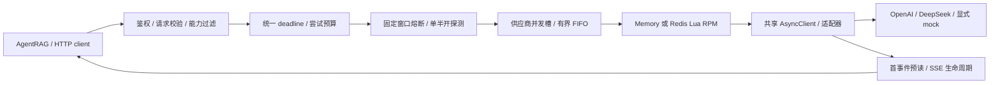

# LLM Gateway · 多模型接入与可靠性网关

一个可以在 Windows/Python 3.12 运行的异步后端项目，展示连接池、文本 SSE、资源释放、有界排队、RPM、总截止时间、有限重试/切换和固定窗口熔断。**只支持单实例单 worker。默认显式 mock，不会调用真实 LLM。** 真实模式缺凭据启动失败，上游错误不会返回 mock。

OpenAI 和 DeepSeek 共用 Chat Completions 协议适配器，提供两条可配置真实接入路径；目前未取得真实调用验证。供应商和模型能力以 [PROVIDERS.md](docs/PROVIDERS.md) 中的官方资料和限制为准，不宣称完整兼容 OpenAI API。

## 本机启动

首次克隆并安装。已有仓库和虚拟环境时可直接进入仓库目录启动；下列各终端命令均在仓库根目录执行：

```powershell
git clone https://github.com/277Wwj/llm-gateway.git
Set-Location llm-gateway
py -3.12 -m venv .venv
.\.venv\Scripts\python.exe -m pip install -r requirements.lock
# 可选；默认值已能启动。已有 .env 时保留它。
if (-not (Test-Path .env)) { Copy-Item .env.example .env }
```

终端一启动 mock（仅绑定本机；控制接口没有鉴权）：

```powershell
.\.venv\Scripts\python.exe -m uvicorn gateway.mock_provider:app --host 127.0.0.1 --port 9101 --workers 1 --no-access-log
```

终端二启动网关：

```powershell
.\.venv\Scripts\python.exe -m uvicorn gateway.api:app --host 127.0.0.1 --port 9100 --workers 1 --no-access-log
```

终端三演示普通请求、JSON、函数调用和 SSE：

```powershell
.\.venv\Scripts\python.exe scripts/demo.py
```

[接口文档](http://127.0.0.1:9100/docs)。调用网关使用 `Authorization: Bearer demo-client-key`。上游 mock key 为另一个值，只由服务端配置使用。网关不执行工具；函数调用响应交还应用验证和执行。Ctrl+C 停止两个终端。

## 一键验收、实验和联调

以下脚本自动选空闲端口，启动真实 HTTP 进程，并在 finally 停止；不要求上面的服务已启动：

```powershell
.\.venv\Scripts\python.exe -m pytest -q --junitxml=artifacts/test-results.xml
.\.venv\Scripts\python.exe -m pip check
.\.venv\Scripts\python.exe scripts/fault_experiments.py
.\.venv\Scripts\python.exe scripts/benchmark.py --start-local --requests 40 --concurrency 4 --delay-ms 50
.\.venv\Scripts\python.exe scripts/agentrag_integration.py
```

AgentRAG 联调使用相邻 `agent-rag` 已安装的虚拟环境和原始代码；请先将 [AgentRAG](https://github.com/277Wwj/agent-rag) 克隆为同级目录并按其 README 安装。联调配置 `base_url=<临时网关>/v1`、model=`demo-chat`、网关调用 key；它的 `chat_completions` 模式代表实际 HTTP 适配路径，**本轮终点仍是 mock**。脚本用临时业务/检查点目录验证问答→草稿→确认→重复确认，不修改 AgentRAG `.env`、核心代码或已有数据。原始结果保存于 `artifacts/agentrag-integration.json`，不保留确认 token。

实际结果、环境边界、基准分母与原始记录见 [VERIFICATION.md](VERIFICATION.md)。测试未设置 `LLMGW_TEST_REDIS_URL` 时明确跳过真实 Redis 项，不把内存后端测试计为 Redis 验证。

## 接口与支持范围

| 路径 | 行为 |
| --- | --- |
| `GET /health` | 进程存活、显式 mode/rate_backend；不是上游或 Redis readiness |
| `GET /v1/models` | 需要网关 key；列出别名、候选供应商和能力 |
| `POST /v1/chat/completions` | 文本非流式、非流式工具调用、JSON 对象、文本 SSE |
| `GET /metrics` | 需要网关 key；Prometheus 格式 |
| `GET /admin/state` | 需要网关 key；每供应商 active/waiting、熔断状态和探测信息 |

请求字段：`model/messages/stream/temperature/max_tokens/response_format/tools/tool_choice`。只支持一条 choice，message.content 只接受字符串；tool_choice 接受 auto/none/required。工具定义含 function.name/description/parameters。工具历史可使用 assistant.tool_calls 和 tool.tool_call_id。参数限制见 `/docs`。未知字段返回 422，未知模型 404，候选无所需能力返回 400，均不请求上游。工具+JSON、流式工具、流式 JSON、多模态、推理增量、JSON Schema strict、任意 extra_body 均不开放给客户端。

请求体最多 1 MiB；普通上游响应最多 2 MiB；SSE 单事件最多 256 KiB。配置的能力是运营者声明，只有满足整组能力的候选会被选中。路由是配置顺序的优先级切换，没有成本优化或自适应调度。别名 `balanced-chat` 也只是按序切换，不保证负载均衡。

所有响应含服务端生成的 `X-Request-ID`，上游与结构化日志使用同一个 ID；不接受客户端任意上游地址或任意 Authorization 转发。错误只含安全 code/request_id，不回显上游错误正文、key 或 prompt。

## 截止时间、取消与失败语义

默认从已鉴权且完成请求校验后开始 15 秒总预算；排队、重试等待、切换、上游读取和流输出共用绝对截止时间。单次排队等待最多 3 秒，候选准入/尝试最多 3 轮；实际 HTTP 尝试不会超过该上限。HTTPX 连接最多 5 秒、读空闲最多 30 秒，仍受剩余总预算截断。连接池不跟随重定向、不使用系统 HTTP 代理。

每供应商区分 60 秒窗口 RPM 和在途并发。先取得并发槽再检查 RPM，RPM 超限不长期持有槽；队列有容量和截止时间。超限且剩余时间不足以重试时保留 429/Retry-After，不虚构已经耗尽超时。切换其他供应商无需等原供应商，但切回时仍遵守它的 Retry-After。

SSE 先读取并校验上游第一个有效事件，再返回下游 200。合法 role-only 事件也算有效事件；首个内容另计。HTTP 头/事件一旦交付即不再尝试换模型；中途失败发送 `event: error`，不会发送成功 `[DONE]`，调用方必须检查结束标志。只有 finish chunk + DONE 才算上游成功完成。

客户端断开会取消正在排队/请求/读流的任务，并 finally 关闭 HTTP response、归还槽、释放半开探测资格。**取消无法保证供应商停止计算或不计费**；本地关闭只保证已验证的本地资源回收。SSE 完成指标表示网关已观察到完整上游协议，不证明客户端实际消费了最后一字节。

固定窗口错误率熔断有最小样本、冷却和单个半开探测；参数/鉴权错误、准入拒绝和客户端取消不计供应商故障。详细算法与 Redis Lua 见 [POLICIES.md](docs/POLICIES.md)。

## Redis 与真实供应商

内存后端必须显式选择；`GATEWAY_RATE_BACKEND=redis` 时错误返回 503，没有静默降级。Redis 只协调 RPM，并发与熔断状态仍在当前进程。不可用多个 worker 或副本冒充已支持分布式网关。进程不自动阻止操作者使用不同端口启动第二实例，这是部署约束。

真实 Redis 的本次构建、启动和复现命令见 [Redis 验证记录](docs/REDIS_VERIFICATION.md)。接现成 Redis 可设置：

```powershell
$env:GATEWAY_RATE_BACKEND='redis'
$env:GATEWAY_REDIS_URL='redis://127.0.0.1:6379/0'
$env:LLMGW_TEST_REDIS_URL='redis://127.0.0.1:6379/15'
.\.venv\Scripts\python.exe -m pytest tests/test_policies.py -q
```

真实模型：在本项目 `.env` 中将 mode 改 real、config 改 configs/real.json，设置私有网关 key 和两个独立供应商 key（也可导出环境变量）。启动后分别验证单路别名，以下命令会产生真实请求和可能的费用：

```powershell
# 客户端环境导出与服务端一致的私有 GATEWAY_API_KEY；不在命令行写入密钥。
.\.venv\Scripts\python.exe scripts/verify_real.py --model openai-chat --output artifacts/real-openai.json
.\.venv\Scripts\python.exe scripts/verify_real.py --model deepseek-chat --output artifacts/real-deepseek.json
```

没有凭据时无需执行，不创建假的 real 验证记录。当前 real 配置要求两家都有凭据；只接一家时复制配置并删除未配置的供应商及相应路由。模型示例随官方服务变化，需要真实账号核验。

## 架构与指标



`gateway_requests_total` 从已鉴权和完成 schema 校验的逻辑请求开始计数；未知别名/能力拒绝也计入 error，鉴权/422/413 不进入该分母。`gateway_request_outcomes_total{outcome}` 区分 success/error/timeout/cancelled，`gateway_upstream_attempts_total{provider}` 与 `gateway_retries_total` 记录实际 HTTP 尝试。队列耗时、首个非空文本内容、完整逻辑耗时均为 histogram；工具-only 响应不伪造文本首内容时间。active/waiting/circuit gauge 在抓取时更新。

完成吞吐用 `rate(gateway_request_outcomes_total{outcome="success"}[1m])`；终结请求完成率用 success 的 rate 除以所有 outcomes 的 rate。另看 requests 与 outcomes 差额识别在途请求。请求 ID 只在响应/日志，不作为指标标签；标签只含受控供应商名称和固定结果类别。

下一阶段：取得凭据逐供应商实测；增加压力时长与固定种子工作负载；建立上下游断连/写背压更广覆盖；按真实需求再做多租户公平调度、多实例并发租约、流式工具增量和部署高可用。本轮没有 Docker/Compose 交付，也没有生产吞吐或成本优化承诺。
